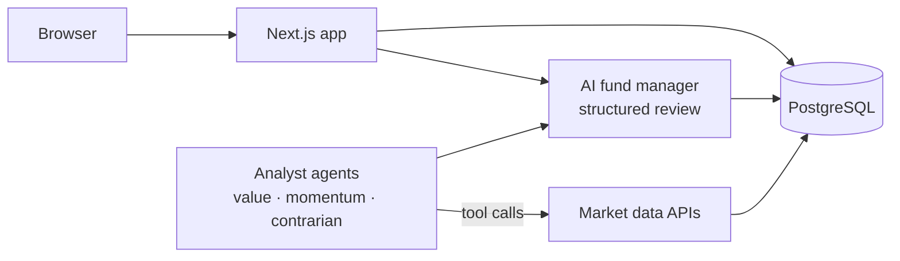

# Vesto

**An AI trading desk where every trade needs a thesis.** I pitch trades alongside 3 AI analyst agents. An AI fund manager reviews every pitch, only approved trades get executed (paper money), and a scorecard tracks whose calls actually beat the S&P 500.

> 🚧 **Status:** in active development (v1 target: December 2026). This README tracks what's built and what's next.

<!-- Add once it exists:  -->
<!-- Live demo: coming soon -->

## Why Vesto?

Brokers like Robinhood, Public and Alpaca now let AI agents place real trades, but nobody makes those agents *justify* them. Most AI investing tools either hand you data or hand you an answer. Almost none grade your reasoning or check later whether a thesis was right.

Vesto fills that gap with one rule: **no trade without a reviewed thesis**, for humans and agents alike. Every pitch gets scored, every outcome gets tracked, and you learn whose reasoning holds up.

## How it works

1. **Research:** pick a stock and look at its real price history and fundamentals.
2. **Pitch:** write a buy or sell thesis, including what would prove you wrong.
3. **Review:** the AI fund manager scores the pitch with a structured review (score, verdict, feedback). The trade only executes if it's approved.
4. **Agents pitch too:** 3 analyst agents (value, momentum, contrarian) use tool calling to pull data and write their own pitches through the same gate.
5. **Scorecard:** as real prices move, Vesto measures each thesis against the S&P 500 and tracks hit rate, cost and latency per pitch.

## Architecture



## Tech stack

| Layer | Tech |
|---|---|
| Frontend + API | Next.js (TypeScript, App Router), Tailwind CSS, shadcn/ui |
| Database | PostgreSQL 16 |
| AI | LLM with structured outputs and tool calling |
| Market data | Massive (formerly Polygon.io) for daily prices, Finnhub for fundamentals |
| Infra | Docker Compose, GitHub Actions CI |

## Getting started

**Prerequisites:** Docker Desktop

```bash
git clone https://github.com/gautamreddy0/vesto.git
cd vesto
cp .env.example .env    # then fill in your values
docker compose up --build
```

Then open http://localhost:3000.

## Roadmap

- [ ] Repo setup: Next.js + Postgres running in Docker Compose
- [ ] Database schema and migrations
- [ ] Real daily prices for 20 S&P 500 stocks
- [ ] Pitch composer and AI fund manager review
- [ ] First analyst agent with tool calling, then the other 2
- [ ] Scorecard: 5-day hit rate vs S&P 500, cost and latency per pitch
- [ ] UI polish, tests, CI, deployment

**Later:** a C++ prediction market exchange (order book and matching engine), plus routing all LLM calls through my [LLM Gateway](#) project.

## Docs

- [Product definition](docs/product.md)
- [Market research](docs/research.md)
- [Walkthrough](docs/walkthrough.md)

## Disclaimer

Vesto uses paper money only. Nothing here is financial advice.
